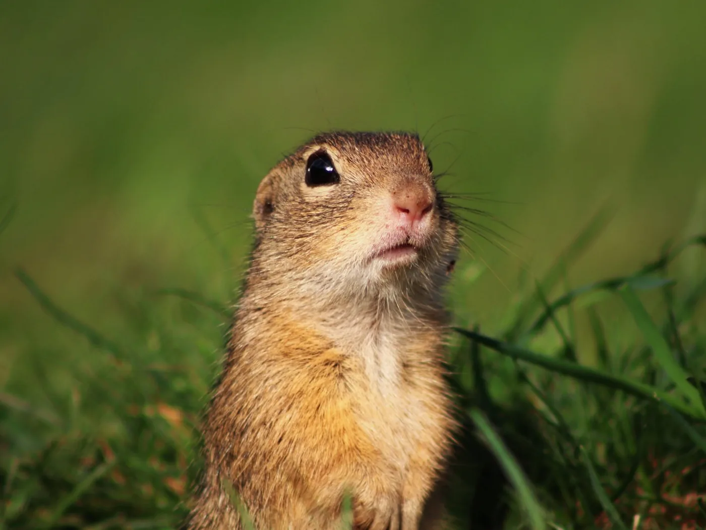
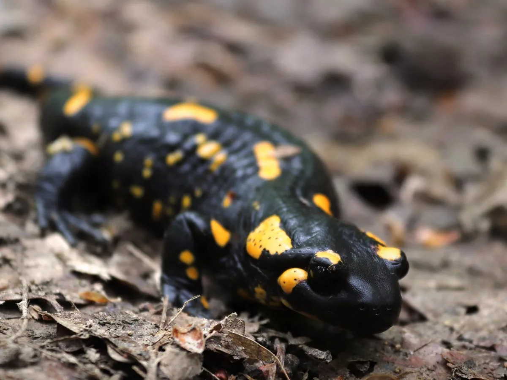
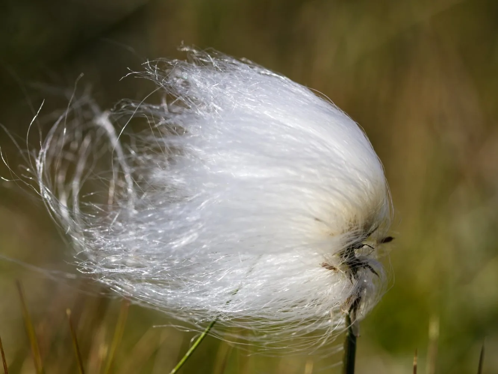
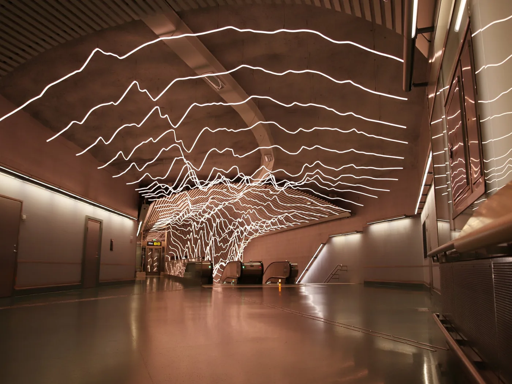

::: {#about-block}

## Hi, I'm Carolina

I am a biologist and visual science communicator. I studied biochemistry in Lisbon and then moved to Germany for my PhD in cell and developmental biology at the University of Münster. I am now a postdoc at ISTA in Vienna, where I combine cell and developmental biology with biophysics to understand what shapes the geometry of early embryos.

For nearly a decade, I have turned complex biology into visual stories: first for my own papers, then for colleagues, reviews and outreach. Follow [my path](path.qmd) or download my [CV (PDF)](assets/cv/carolina-camelo-cv.pdf).

[Portrait: Stefanie Santer, VISTA Science.]{.portrait-credit}

:::

## Outside the lab {#outside-the-lab}

Away from the microscope, I'm usually drawing, painting or making crafts, or out hiking and travelling, often with a camera.

::: {layout-ncol=4}
{group="photography" fig-alt="A small ground squirrel stands upright in green grass, looking up."}

{group="photography" fig-alt="A black salamander with bright yellow spots walks over dry leaves."}

{group="photography" fig-alt="A close-up of a white, fluffy cottongrass seed head blowing in the wind."}

{group="photography" fig-alt="A metro station with white zigzag lines painted across its curved rock ceiling."}
:::

::: {.photo-credit}
All photos © Carolina Camelo.
:::

## Get in touch {#get-in-touch}

I'm always happy to talk about science, illustration and communication. The easiest way to reach me is by [email](mailto:carolina.camelo92@gmail.com).
