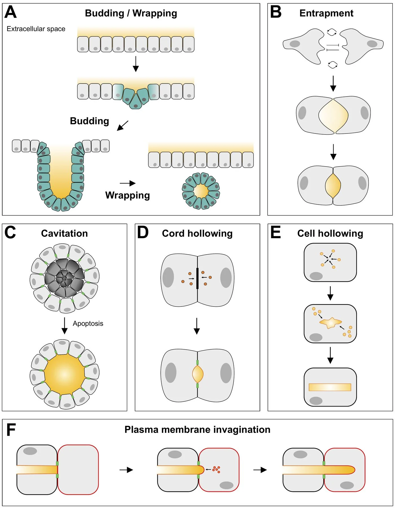

::: {.project-meta}
[**For** ]{}
[**Tools** ]{}
:::

{fig-alt="Six panels comparing ways epithelial tubes form a lumen: budding and wrapping, entrapment, cavitation, cord hollowing, cell hollowing and plasma membrane invagination." group="gallery"}

Full-page conceptual diagram built for my own review chapter, synthesising several distinct molecular mechanisms of epithelial lumen formation into one comparative visual layout.

<!-- Optional: expand into "The brief / My approach / The outcome" sections, like the template. -->

::: {.reference}
Camelo C, Luschnig S (2021). Cells into tubes: Molecular and physical principles underlying lumen formation in tubular organs. *Current Topics in Developmental Biology* 143: 37–74. [doi:10.1016/bs.ctdb.2020.09.002](https://doi.org/10.1016/bs.ctdb.2020.09.002)
:::
