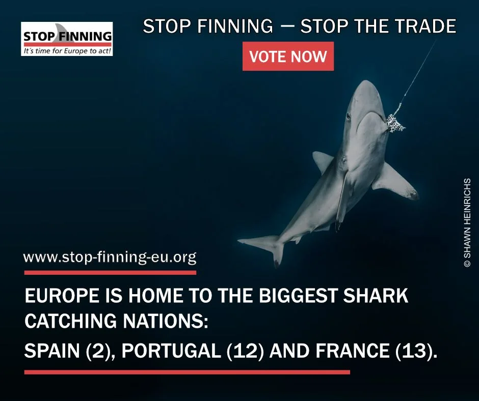
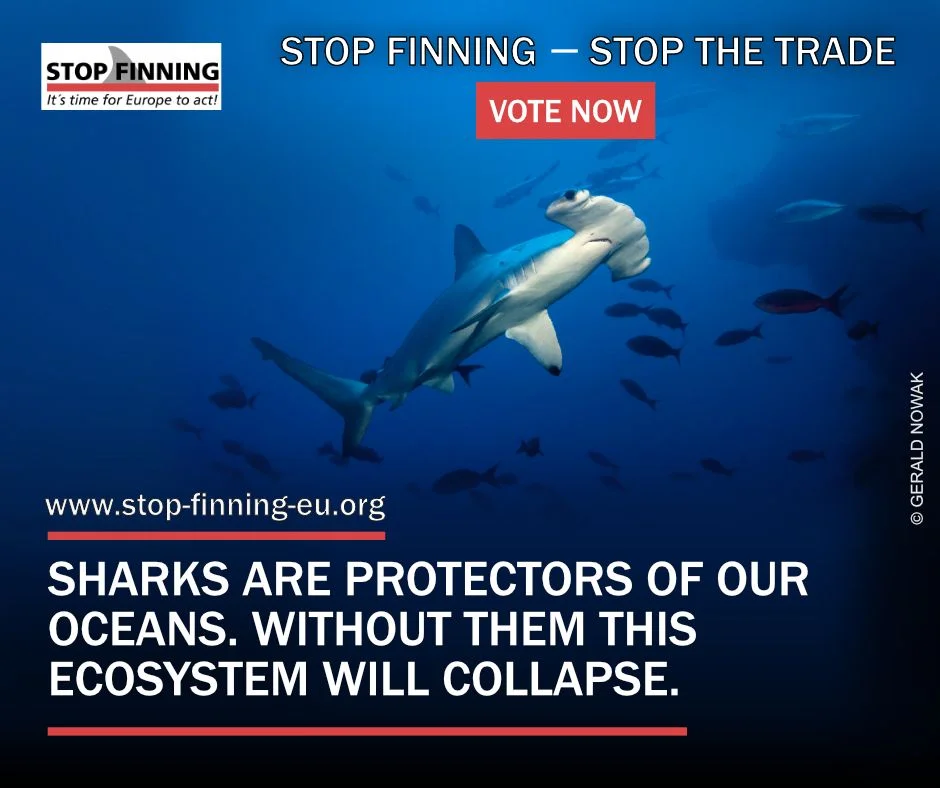

::: {.project-meta}
[**For** ]{}
[**Tools** ]{}
:::

{fig-alt="Social media post: an underwater photo of a shark with the headline 'Stop finning, stop the trade', a red 'Vote now' button and a fact about European shark catches." group="gallery"}

{fig-alt="Social media post: a hammerhead shark underwater with the headline 'Stop finning, stop the trade' and the message that sharks are protectors of our oceans." group="gallery"}

Two posts from a set designed as a volunteer for the Stop Finning EU coalition campaign, calling for an EU-wide ban on the shark fin trade. Designed in Adobe Photoshop and Illustrator from wildlife photography supplied by the campaign, with a consistent visual system: fixed logo placement, a repeatable call-to-action treatment and a clear typographic hierarchy. The posts were then adapted into localised versions for several EU languages from translations provided by the coalition.

<!-- Optional: expand into "The brief / My approach / The outcome" sections, like the template. -->

::: {.reference}
Stop Finning EU coalition campaign, 2021. Photography supplied by the campaign.
:::
