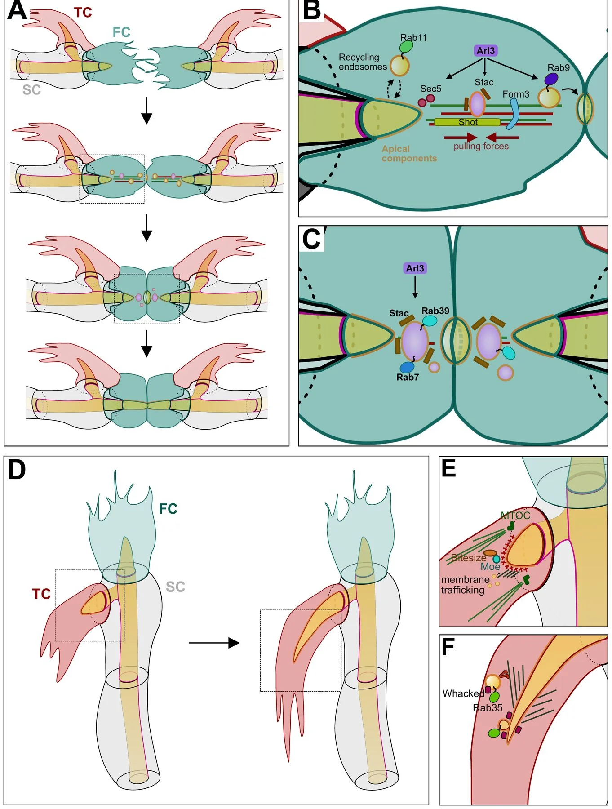

::: {.project-meta}
[**For** ]{}
[**Tools** ]{}
:::

{fig-alt="Six panels following Drosophila tracheal fusion cells from whole-cell geometry down to individual membrane trafficking components." group="gallery"}

Detailed cell-type and molecule-level schematic of seamless lumen formation during *Drosophila* tracheal fusion, built for the same review: six coordinated panels tracking the process from whole-cell geometry down to individual trafficking components.

<!-- Optional: expand into "The brief / My approach / The outcome" sections, like the template. -->

::: {.reference}
Camelo C, Luschnig S (2021). *Current Topics in Developmental Biology* 143: 37–74. [doi:10.1016/bs.ctdb.2020.09.002](https://doi.org/10.1016/bs.ctdb.2020.09.002)
:::
