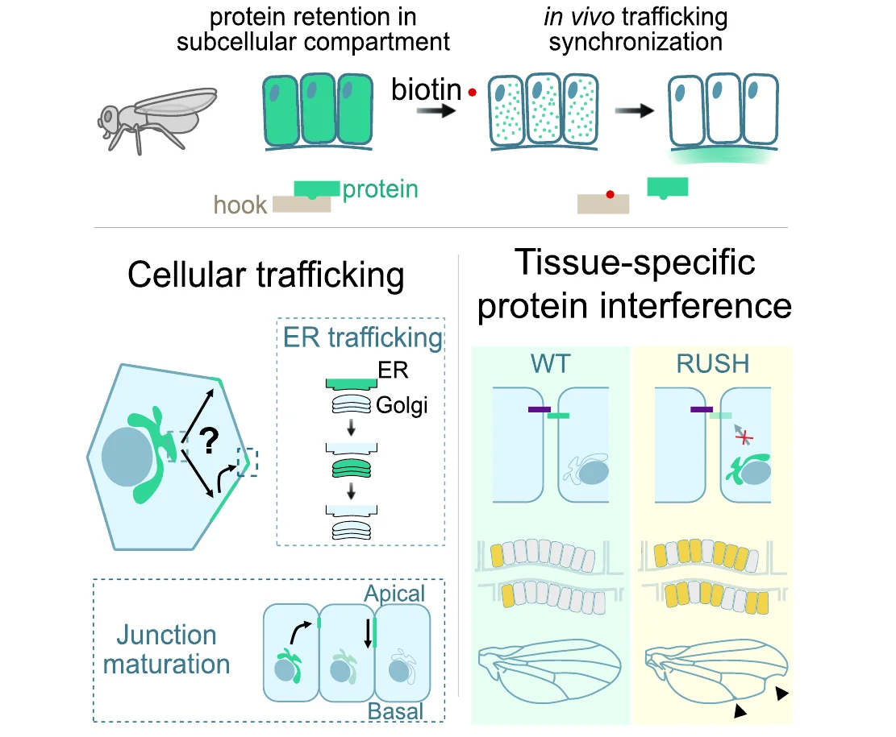

::: {.project-meta}
[**For** ]{}
[**Tools** ]{}
:::

{fig-alt="Schematic of the RUSH system in Drosophila: a protein held by a hook in the ER is released with biotin, enabling studies of cellular trafficking and tissue-specific protein interference." group="gallery"}

Multi-panel schematic explaining the RUSH (Retention Using Selective Hooks) trafficking system as applied in *Drosophila*, built for my own paper to make a technically dense methods figure accessible at a glance.

<!-- Optional: expand into "The brief / My approach / The outcome" sections, like the template. -->

::: {.reference}
Glashauser J\*, Camelo C\*, Hollmann M, et al. (2023). Acute manipulation and real-time visualization of membrane trafficking and exocytosis in *Drosophila*. *Developmental Cell* 58(8): 709–723. (\*co-first authors) [doi:10.1016/j.devcel.2023.03.006](https://doi.org/10.1016/j.devcel.2023.03.006)
:::
