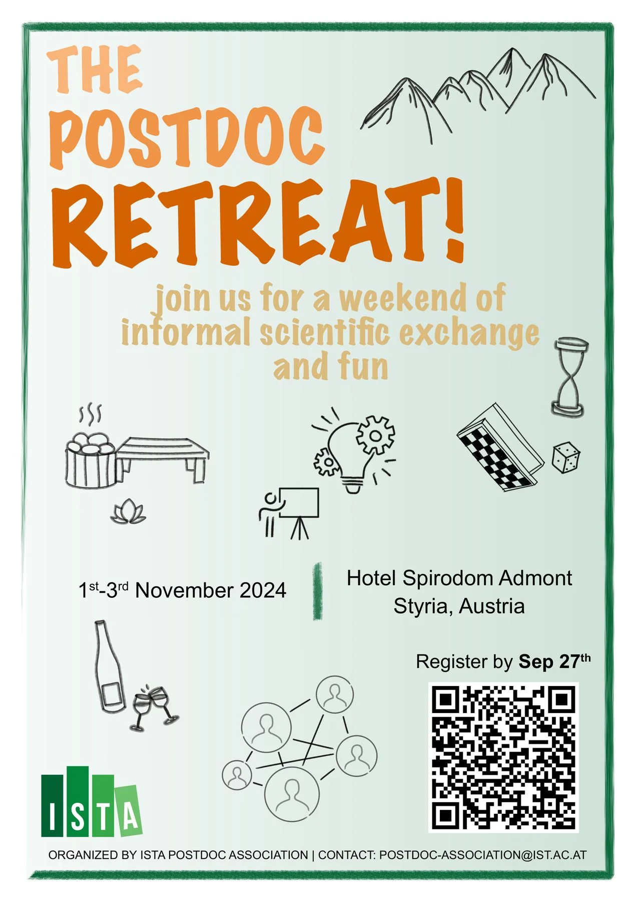

::: {.project-meta}
[**For** ]{}
[**Tools** ]{}
:::

{fig-alt="Event poster with bold orange hand-lettered title 'The Postdoc Retreat!', line drawings of mountains, a lecture and a toast, event dates and a registration QR code." group="gallery"}

Hand-illustrated event poster designed for the annual ISTA postdoc retreat, as part of an ongoing role coordinating communication and promotional materials for the Postdoc Association.

<!-- Optional: expand into "The brief / My approach / The outcome" sections, like the template. -->

::: {.reference}
ISTA Postdoc Association, November 2024.
:::
