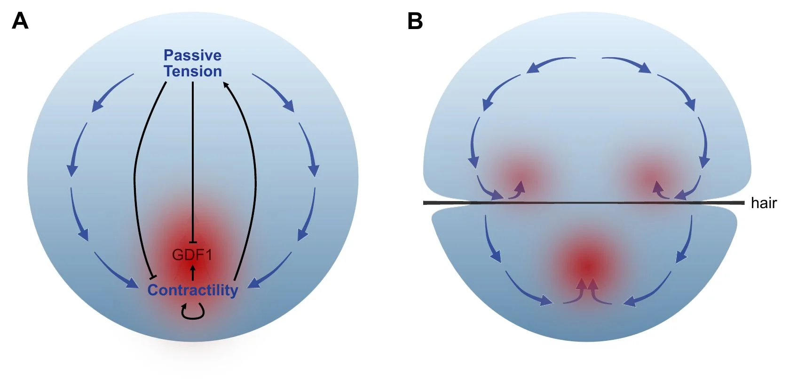

::: {.project-meta}
[**For** ]{}
:::

{fig-alt="Two embryo-like spheres: red spots of signal concentration surrounded by blue arrows showing a mechanical feedback loop, which self-organises into localised spots that predict hair follicle positions." group="gallery"}

Diagram of a reaction–diffusion feedback loop, built to make Turing-pattern mechanics intuitive for a broad cell-biology readership. Created as co-author on the dispatch, translating the paper's reaction–diffusion model into a colour-coded schematic: red for GDF1 signal concentration, blue for the mechanical feedback loop. Together they show how the interaction self-organises into the localised spots that predict real hair follicle positions.

<!-- Optional: expand into "The brief / My approach / The outcome" sections, like the template. -->

::: {.reference}
Hino N, Camelo C, Heisenberg CP (2024). Development: Turing mechanics. *Current Biology* 34(24): R1230–R1232. [doi:10.1016/j.cub.2024.10.065](https://doi.org/10.1016/j.cub.2024.10.065)
:::
