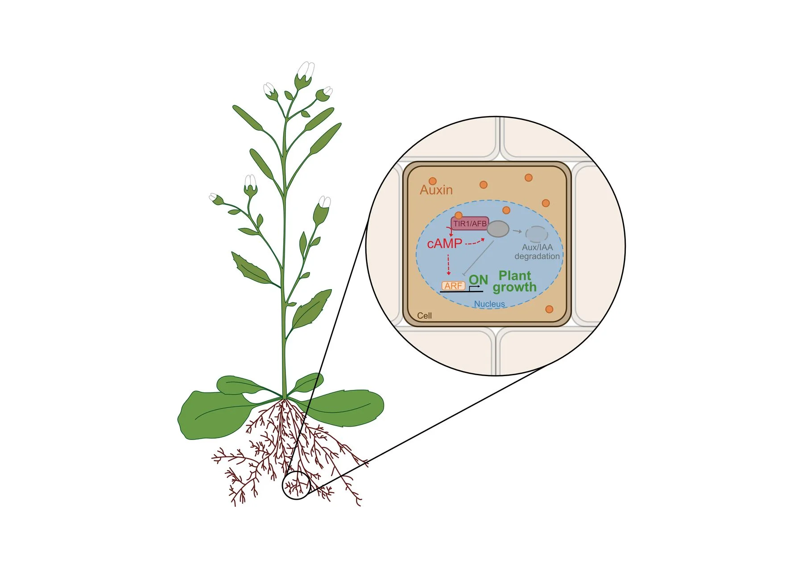

::: {.project-meta}
[**For** ]{}
[**Tools** ]{}
:::

{fig-alt="A flowering plant with a magnified circle showing a root cell, where auxin signalling through cAMP switches on plant growth." group="gallery"}

Designed and credited as the illustrator for an ISTA news feature explaining a *Nature* publication from the Friml group to a general institutional audience. Made during a job-shadowing placement in the ISTA Communications Department, working directly with the science writer and journalist on the piece.

<!-- Optional: expand into "The brief / My approach / The outcome" sections, like the template. -->

::: {.reference}
ISTA News, March 2025, covering Chen & Friml et al., *Nature* (2025). [Read the news feature](https://ista.ac.at/en/news/updating-the-textbook/) <!-- TODO: check this link -->
:::
