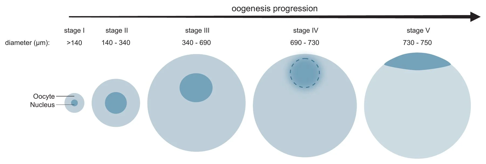
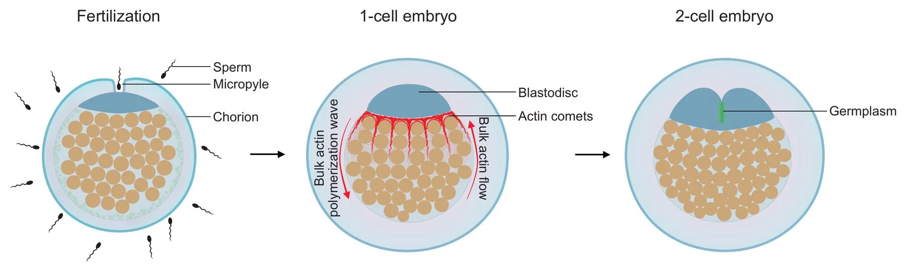

::: {.project-meta}
[**For** ]{}
[**Tools** ]{}
:::

{fig-alt="Zebrafish oocytes at five stages, growing in size from left to right along an arrow labelled oogenesis progression." group="gallery"}

{fig-alt="Three zebrafish embryos showing fertilisation, the 1-cell embryo with the blastodisc forming, and the 2-cell embryo." group="gallery"}

Two panels from a six-figure set tracing zebrafish oocyte development for a colleague's open-access review: the overview establishing scale across all five oocyte stages, and the closing panel following fertilisation through to the 2-cell embryo. Illustrated from primary literature and the author's own data to build a visually consistent series across a long, multi-stage developmental sequence.

<!-- Optional: expand into "The brief / My approach / The outcome" sections, like the template. -->

::: {.reference}
Figure 1 in Hofmann & Heisenberg, *Seminars in Cell & Developmental Biology* 175 (2025), credited in the Acknowledgements. [doi:10.1016/j.semcdb.2025.103650](https://doi.org/10.1016/j.semcdb.2025.103650)
:::
