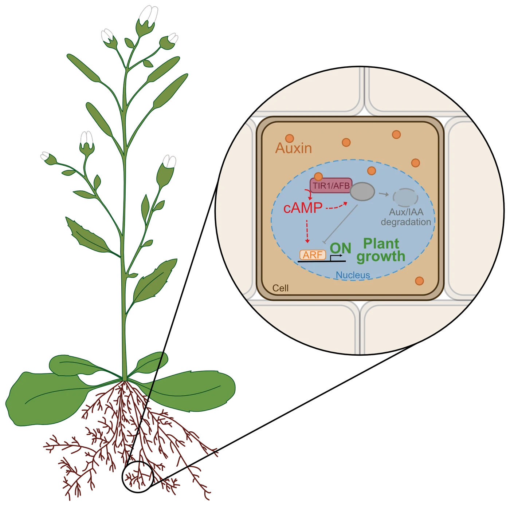

<!-- The page title is hidden; the hero below acts as the heading. -->

::: {.hero}
::: {.hero-text}
[I turn science into pictures and stories.]{.hero-title .h1 .d-block}

[I'm a developmental cell biologist by training and a visual communicator by inclination. For nearly a decade I've been translating complex cell and developmental biology into clear visual stories.]{.hero-lead .d-block}
:::

{fig-alt="Illustration of a flowering plant with a magnified view of a root cell, from my auxin signalling schematic for ISTA News." .lightbox-skip}
:::

::: {.doors}
::: {.door}
### [Illustration & Communication](illustration/index.qmd){.stretched-link}
Illustrations, graphics and outreach projects that make complex science clear.

[See the portfolio →]{.door-cta}
:::

::: {.door}
### [Science](science/index.qmd){.stretched-link}
My research on how early embryos build their shape, plus publications and experience.

[Explore my research →]{.door-cta}
:::
:::

## Featured work

::: {#featured}
:::

[All projects →](illustration/index.qmd)
