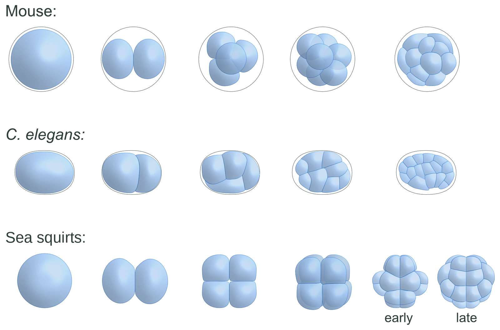

Take eight balls and try to pack them together: there are many ways to do it. Embryos face the same puzzle in their first divisions, and each species solves it in its own way. A sea squirt, a zebrafish, a mouse and a worm all arrange their first cells differently, yet within each species the arrangement is the same, embryo after embryo. How do cells "know" how to pack? I study how the contacts between cells, and the molecular "glue" that holds them together, shape the early embryo.

{width="70%" fig-align="center" fig-alt="Three rows of embryo drawings, from one cell to many, for the mouse, the worm C. elegans and sea squirts. Each species arranges its cells in a different pattern: loose and rotated in the mouse, elongated in the worm, and in symmetric blocks of four in sea squirts."}

I trained as a biochemist and have spent my research career in cell and developmental biology. During my PhD in Münster, I studied how the tubes of the fruit fly's breathing system connect to each other. Now, as a postdoc in the Morphogenesis in Development group at ISTA, I work on early embryos of the sea squirt *Phallusia*.

::: {.doors .three}
::: {.door}
### [Research](research.qmd){.stretched-link}
What I work on, in plain language.

[Read more →]{.door-cta}
:::

::: {.door}
### [Publications](publications.qmd){.stretched-link}
Papers and preprints.

[See the list →]{.door-cta}
:::

::: {.door}
### [Outreach](outreach.qmd){.stretched-link}
Talks, lab visits and writing for the public.

[See more →]{.door-cta}
:::

:::
