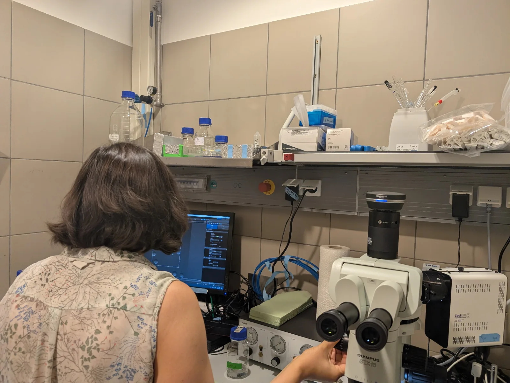
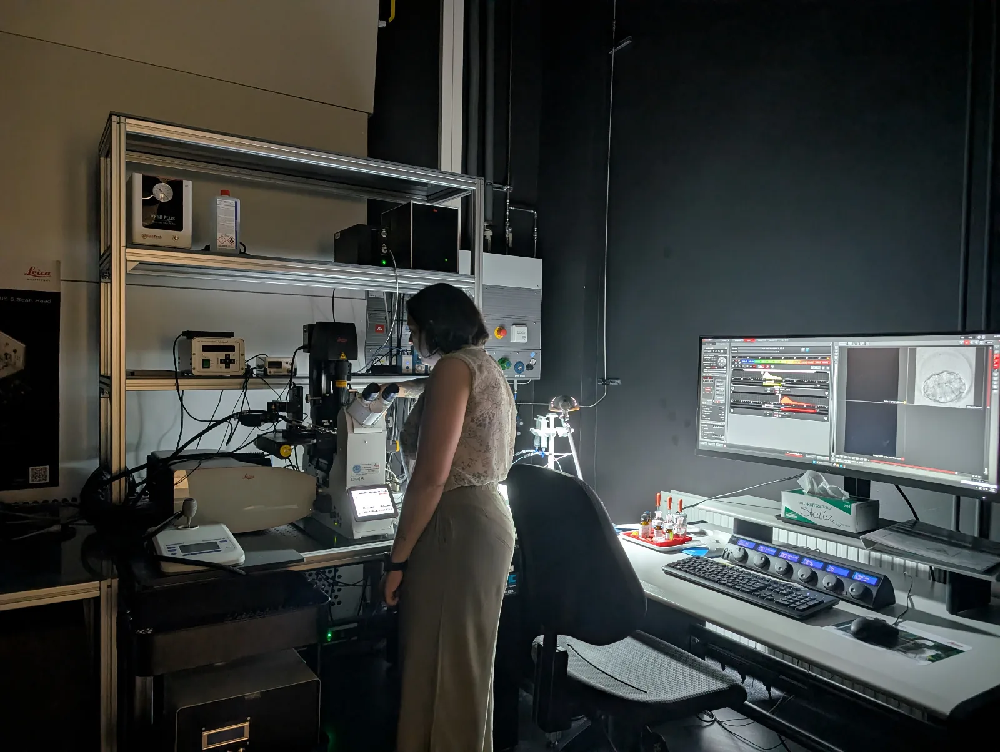

::: {.todo}
**DRAFT:** check and rewrite in your own words. Add 1–3 photos (see the notes in the comments below). Delete this yellow box when you're happy.
:::

<!-- TODO: one or two sentences in your own words on WHY you do outreach. A suggestion to adapt:
"I love showing people what happens inside an embryo in its first hours, and what everyday life in a research lab really looks like." -->

I enjoy sharing my research beyond the lab: explaining how a handful of cells builds an embryo, and showing what everyday life as a scientist really looks like.

## Talks and lab visits

**Meet the Scientist** · *VISTA Science*\
A public talk and lab tour on embryonic development, which I co-presented.

::: {layout-ncol=3}
{group="outreach" fig-alt="A gloved hand holds a translucent, yellowish sea squirt in front of a seawater aquarium."}

{group="outreach" fig-alt="A researcher, seen from behind, works at a stereo microscope next to a computer screen."}

{group="outreach" fig-alt="A researcher stands at a confocal microscope in a dark room; an embryo is visible on the computer screen."}
:::

[Photos: Elisa Warmuth, VISTA Science.]{.small .text-muted}

**AITHYRA Life Sciences School 2026**\
As a guest researcher in this outreach programme for Ukrainian high-school science students, I gave a talk on how early embryos take shape and showed the students zebrafish embryos and larvae in the lab.

## Podcast

**Next Gen Scientist** · *VISTA Science*\
I was a guest on this video podcast about paths into a research career. [Watch the episode on YouTube](https://www.youtube.com/watch?v=jNGvrUF85DM)

## Writing

**Letters to a Pre-Scientist** · *since 2023*\
As a pen pal, I write to pre-college students from underserved backgrounds about science and life as a scientist.

---

Many of these activities come with illustrations and design work. You can find them in [Illustration & Communication](../illustration/index.qmd).
