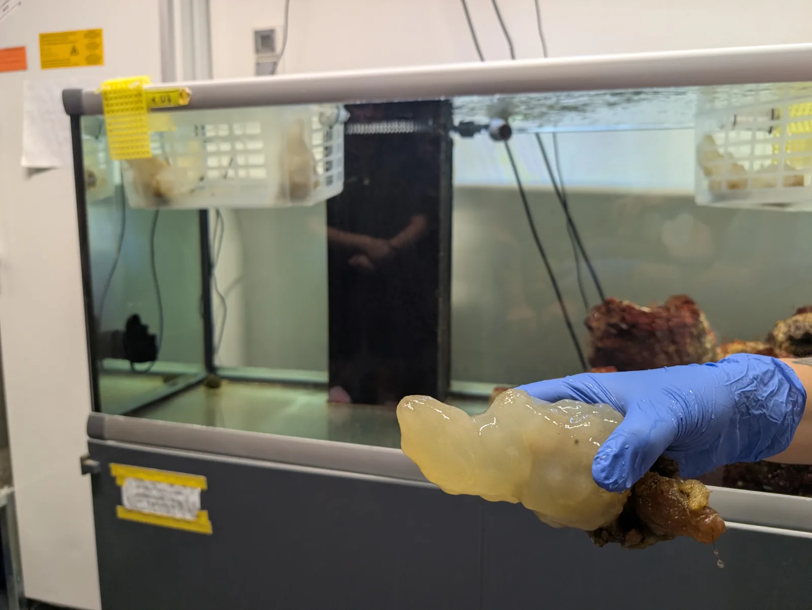

For me, communicating science isn't an add-on to research: it's part of the job. Knowledge grows when it's shared. Whether I'm drawing a figure, giving a talk or showing students embryos under the microscope, explaining what I do is often the part I enjoy most.

## Talks and lab visits

**Meet the Scientist** · *VISTA Science*\
A public talk and lab tour on embryonic development.

::: {layout-ncol=3}
{group="outreach" fig-alt="A gloved hand holds a translucent, yellowish sea squirt in front of a seawater aquarium."}

{group="outreach" fig-alt="A researcher, seen from behind, works at a stereo microscope next to a computer screen."}

{group="outreach" fig-alt="A researcher stands at a confocal microscope in a dark room; an embryo is visible on the computer screen."}
:::

::: {.photo-credit}
Photos: Elisa Warmuth, VISTA Science.
:::

**AITHYRA Life Sciences School 2026**\
As a guest researcher in this outreach programme for Ukrainian high-school science students, I gave a talk on how early embryos take shape and showed the students zebrafish embryos and larvae in the lab.

## Podcast

**Next Gen Scientist** · *VISTA Science*\
I was a guest on this video podcast about paths into a research career. [Watch the episode on YouTube](https://www.youtube.com/watch?v=jNGvrUF85DM)

## Writing

**Letters to a Pre-Scientist** · *since 2023*\
As a pen pal, I write to pre-college students from underserved backgrounds about science and life as a scientist.

---

Many of these activities come with illustrations and design work. You can find them in [Illustration & Communication](../illustration/index.qmd).
